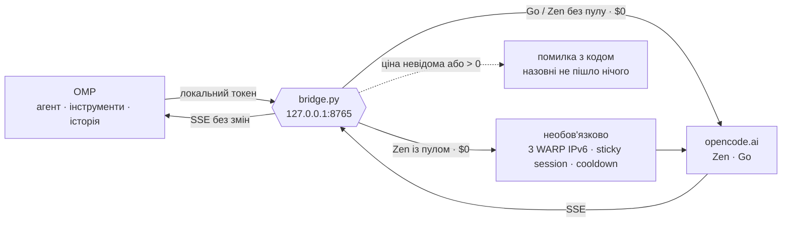

<p align="center">
  
</p>

<h1 align="center">omp-bridge</h1>

<p align="center">
  <b>Безкоштовні моделі OpenCode у звичайному <a href="https://github.com/can1357/oh-my-pi">Oh My Pi</a>.</b><br>
  Один файл Python · нуль залежностей · нуль гривень за токен — або чесна помилка
</p>

---

## Одним абзацом

OpenCode тримає пул безкоштовних моделей, але шлюз пускає до них тільки
запити, схожі на OpenCode: його User-Agent, сесія в його форматі, конкретні
імена інструментів, обов'язковий стрімінг. OMP — інший агент, тому чує
`403 FreeTierError`. Можна запускати OpenCode CLI поруч, форкати OMP або
ставити важкий проксі. Цей міст робить менше: стоїть на `127.0.0.1`, надає
запиту OMP правильну форму, пропускає **тільки** моделі з підтвердженою
нульовою ціною і повертає потік як є. Агентом лишається OMP: його
інструменти, його історія, його reasoning.

Для Zen є необов'язковий пул із трьох WARP IPv6. Сесія тримається одного
виходу; після 429 наступний її запит автоматично переходить на доступний.
Налаштування зберігається один раз, звичайний запуск читає його сам.



## Фейс-контроль

Кожен запит проходить ту саму перевірку на вході. Не пройшов — повертається
помилка з кодом, і до OpenCode не йде жодного байта.

| На вході питають | Якщо ні |
|---|---|
| Ти з цієї машини? Правильний Host, без браузерного Origin, правильний локальний токен | `401` / `403` |
| Модель є в живому каталозі OpenCode, і ціну $0 підтверджують офіційна таблиця або models.dev? | `403 PaidOrUnknownModelBlocked` |
| Перевірці каталогу менше 15 хвилин? | Перевіряє заново. Не вийшло — `503`, старий список не рахується |
| Запит стрімінговий? | `400 StreamingRequired` |
| Модель не намагається викликати інструмент-заглушку? | `409` ще до того, як OMP щось виконає |
| Потік закінчився фінальною подією? | `502 TruncatedStream`, а не «ну, щось прийшло» |

## Чого він не робить ніколи

- не переходить на платну модель, коли безкоштовна впала;
- не перебирає ключі, акаунти чи регіони;
- не повторює запити сам — повтори й fallback вирішує OMP;
- не читає auth-файли OMP чи OpenCode і cookies браузера;
- ядро моста не запускає підпроцесів і не виконує інструментів — це робить OMP;
- не додає Python/JavaScript-залежностей; WARP потребує окремих мережевих вузлів.

## Три кроки

```sh
git clone https://github.com/bramms/omp-bridge.git ~/.local/share/omp-free-bridge
python3 ~/.local/share/omp-free-bridge/bridge.py serve --compat-opencode
```

В іншому терміналі:

```sh
omp -e ~/.local/share/omp-free-bridge/extension.mjs --model opencode-zen-free/big-pickle
```

У OMP наберіть `/free-models` — побачите, що сьогодні безкоштовне. Постійне
підключення, автозапуск через systemd, ключ Go і розбір кожної помилки —
у [посібнику](docs/ПОСІБНИК.md).

Без збереженого пулу це прямий режим. Якщо `zen-proxies.json` уже налаштований,
той самий `serve` використовує його.

## Запуск із пулом WARP

Спочатку один раз підніміть три вузли та створіть їхні реєстрації за
[посібником](docs/ПОСІБНИК.md#три-вузли-warp-необовязково). Потім збережіть пул:

```sh
cd ~/.local/share/omp-free-bridge
mkdir -p ~/.config/omp-free-bridge
install -m 600 deploy/zen-proxies.json ~/.config/omp-free-bridge/zen-proxies.json
```

Надалі звичайний запуск із пулом — одна команда:

```sh
bash deploy/start-warp.sh --compat-opencode
```

Лаунчер піднімає наявні контейнери й запускає міст; на macOS за потреби
запускає Colima. Нових реєстрацій не створює. Якщо вузли вже працюють,
достатньо звичайного `python3 bridge.py serve --compat-opencode`.

429 ставить проблемний вихід на паузу, наступне звернення сесії використовує
інший. Уже розпочатий POST чи SSE не повторюється. Усі виходи на паузі —
локальний `503 ZenProxyCooldown`; 401/402/403 зупиняють увесь канал.
Go й каталог залишаються прямими. WARP може змінити публічні IP при
перепідключенні; окремі квоти для кожної IPv6 не гарантуються.

## Що всередині

| Файл | Роль |
|---|---|
| [`bridge.py`](bridge.py) | Локальний HTTP, каталог, перевірка ціни, TLS, SSE, пул виходів |
| [`extension.mjs`](extension.mjs) | Провайдери Zen/Go в OMP, ID сесії, команди |
| [`deploy/zen-proxies.json`](deploy/zen-proxies.json) | Приклад збереженого пулу на трьох локальних портах |
| [`deploy/start-warp.sh`](deploy/start-warp.sh) | Запуск WARP-вузлів і моста однією командою |
| [`deploy/warp/`](deploy/warp/) | Три контейнери WARP + tinyproxy, окремі volumes реєстрацій |
| [`deploy/omp-free-bridge.service`](deploy/omp-free-bridge.service) | Автозапуск через systemd |
| [`tests/`](tests) | Логіка, HTTP/CONNECT/TLS, пул і контракт розширень OMP |

Сам міст потребує лише стандартної бібліотеки Python 3.10+ і API розширень OMP.
Для необов'язкових WARP-вузлів потрібен Docker; [налаштування пулу](docs/ПОСІБНИК.md#три-вузли-warp-необовязково).

## Перевірено

**19 жовтня 2026, macOS.** Три різні WARP IPv6; у звичайному фоновому
процесі реальна `429 FreeUsageLimitError` через №3, а наступний запит тієї
самої сесії — завершена `200 BRIDGE_OK` через №1. Без ручного cooldown,
перезапуску чи перереєстрації. [Протокол перевірки](docs/ДОСЛІДЖЕННЯ.md#16-пул-у-звичайному-запуску-й-автоматичне-перемикання-після-429).
97 Python-тестів на 3.13/3.14 та 15 JavaScript-тестів пройшли.

**17 жовтня 2026, OMP 18.11.3.** Чистий `omp --no-extensions -e extension.mjs`
з `opencode-zen-free/big-pickle` прочитав випадковий файл інструментом `read`
і повернув точний вміст. Того дня каталог пропустив 9 моделей Zen і 2 Go.
Список живий: OpenCode змінює його, міст перечитує.

```sh
python3 -m unittest -q tests/test_bridge.py
node --test tests/extension.test.mjs
python3 bridge.py doctor
```

## Чесно про ризики

- **`--compat-opencode` неофіційний.** Шлюз уже раз змінив правила
  (14 жовтня 2026, перехід на V2). Коли це станеться знову, ви отримаєте
  `403`, а не тихий платний запит.
- **Безкоштовне ≠ приватне.** Частина free-моделей може вчитися на ваших
  даних ([Zen Privacy](https://opencode.ai/docs/zen/#privacy)). Секрети й
  чужий код туди не надсилайте.
- **Акаунт.** У спільноті є звіт про блокування після інтенсивних
  експериментів. Не крутіть `probe --all` по колу і не перезапускайте міст,
  щоб скинути 429.
- Проєкт не пов'язаний ні з OpenCode, ні з Oh My Pi.

## Далі

- [Посібник](docs/ПОСІБНИК.md) — встановлення, підключення, команди, помилки
- [Архітектура](docs/АРХІТЕКТУРА.md) — шлях запиту, каталог і гроші, межі
- [Дослідження](docs/ДОСЛІДЖЕННЯ.md) — як шлюз відрізняє «свої» запити і звідки це відомо

Ліцензія [MIT](LICENSE).
