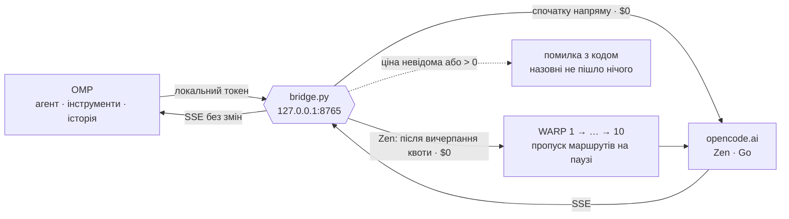

<p align="center">
  
</p>

<h1 align="center">omp-bridge</h1>

<p align="center">
  <b>Безкоштовні моделі OpenCode у звичайному <a href="https://github.com/can1357/oh-my-pi">Oh My Pi</a>.</b><br>
  Один файл Python · нуль залежностей · нуль гривень за токен — або чесна помилка
</p>

---

## Одним абзацом

OpenCode тримає пул безкоштовних моделей, але шлюз пускає до них тільки
запити, схожі на OpenCode: його User-Agent, сесія в його форматі, конкретні
імена інструментів, обов'язковий стрімінг. OMP — інший агент, тому чує
`403 FreeTierError`. Можна запускати OpenCode CLI поруч, форкати OMP або
ставити важкий проксі. Цей міст робить менше: стоїть на `127.0.0.1`, надає
запиту OMP правильну форму, пропускає **тільки** моделі з підтвердженою
нульовою ціною і повертає потік як є. Агентом лишається OMP: його
інструменти, його історія, його reasoning.

Zen починає напряму; після `429 FreeUsageLimitError` автоматично пробує десять
сталих WARP-вузлів по черзі: 1 → 2 → 3 → 4 → 5 → 6 → 7 → 8 → 9 → 10. На паузу стає лише
маршрут, який повернув відмову; відомі паузи пропускаються. Повний `Retry-After`
зберігається між перезапусками. Щохвилини міст перевіряє адреси через сам OpenCode,
фіксує зміни IP й дублікати, не витрачаючи модельну квоту. Підтверджений новий
IP скидає стару квотну й транспортну паузу тільки відповідного WARP.

[Діагностика doctor](#діагностика-doctor) · [Перезапуск WARP](#перезапуск-warp) ·
[Повний посібник](docs/ПОСІБНИК.md)



## Фейс-контроль

Кожен запит проходить ту саму перевірку на вході. Не пройшов — повертається
помилка з кодом, і до OpenCode не йде жодного байта.

| На вході питають | Якщо ні |
|---|---|
| Ти з цієї машини? Правильний Host, без браузерного Origin, правильний локальний токен | `401` / `403` |
| Модель є в живому каталозі OpenCode, і ціну $0 підтверджують офіційна таблиця або models.dev? | `403 PaidOrUnknownModelBlocked` |
| Перевірці каталогу менше 15 хвилин? | Перевіряє заново. Не вийшло — `503`, старий список не рахується |
| Запит стрімінговий? | `400 StreamingRequired` |
| Модель не намагається викликати інструмент-заглушку? | `409` ще до того, як OMP щось виконає |
| Потік закінчився фінальною подією? | `502 TruncatedStream`, а не «ну, щось прийшло» |

## Чого він не робить ніколи

- не переходить на платну модель, коли безкоштовна впала;
- не перебирає ключі, акаунти чи регіони;
- не повторює розпочату генерацію чи SSE та не перестворює мережеві реєстрації;
- не читає auth-файли OMP чи OpenCode і cookies браузера;
- обробник модельних запитів не запускає підпроцесів і не виконує інструментів — це робить OMP;
- не додає Python/JavaScript-залежностей; WARP потребує окремих мережевих вузлів.

## Три кроки

```sh
git clone https://github.com/bramms/omp-bridge.git ~/.local/share/omp-free-bridge
python3 ~/.local/share/omp-free-bridge/bridge.py serve --compat-opencode
```

В іншому терміналі:

```sh
omp -e ~/.local/share/omp-free-bridge/extension.mjs --model opencode-zen-free/big-pickle
```

У OMP наберіть `/free-models` — побачите, що сьогодні безкоштовне. Постійне
підключення, автозапуск через systemd, ключ Go і розбір кожної помилки —
у [посібнику](docs/ПОСІБНИК.md).

Прямий маршрут завжди перший. Якщо `zen-proxies.json` уже налаштований,
той самий `serve` використовує його після вичерпання квоти direct або мережевого збою.

## Запуск із пулом WARP

Спочатку один раз підніміть десять вузлів та створіть їхні реєстрації за
[посібником](docs/ПОСІБНИК.md#десять-вузлів-warp-необовязково). Потім збережіть пул:

```sh
cd ~/.local/share/omp-free-bridge
mkdir -p ~/.config/omp-free-bridge
install -m 600 deploy/zen-proxies.json ~/.config/omp-free-bridge/zen-proxies.json
```

Надалі звичайний запуск із пулом — одна команда:

```sh
bash deploy/start-warp.sh --compat-opencode
```

Лаунчер піднімає наявні контейнери й запускає міст; на macOS за потреби
запускає Colima. Нових реєстрацій не створює. Якщо вузли вже працюють,
достатньо звичайного `python3 bridge.py serve --compat-opencode`.

`429 FreeUsageLimitError` ставить лише відповідний маршрут на паузу за повним
`Retry-After`. Незмінний запит автоматично переходить на наступний доступний
маршрут у порядку direct → WARP 1 → … → WARP 10, кожен не більше одного разу.
Коли всі маршрути на паузі, міст повертає `503 ZenProxyCooldown` із найближчим
терміном відновлення. Автоматичних `registration delete/new` немає.
Мережеві помилки дають маршруту коротку паузу без повтору поточного POST;
наступне звернення може використати інший вихід. Прямий маршрут знову має
пріоритет після завершення його паузи.

Go й каталог залишаються прямими.

## Діагностика doctor

З каталогу репозиторію, коли міст уже запущений (Python 3.10+):

```sh
python3 bridge.py doctor          # читабельні таблиці
python3 bridge.py doctor --json   # повний /health для скриптів
```

У macOS із застарілим системним Python замініть `python3` на встановлений
новіший інтерпретатор, наприклад `python3.14`.

Для direct і всіх десяти WARP таблиці показують:

- модельні спроби, завершені успішні відповіді, 429 і транспортні помилки;
- поточну RAM у МіБ, час від останнього запуску контейнера та стан cooldown;
- окрему таблицю пауз: останню 429, отриманий `Retry-After`, точний кінець паузи та причину;
- окремі спроби/успіхи/помилки перевірок IP й останню підтверджену адресу;
- підсумки, час початку обліку та стан збереження статистики.

Лічильники накопичуються в `~/.config/omp-free-bridge/zen-stats.json` і
переживають перезапуск. Відлік починається з установлення 1.8.0; старі запити
не відновлюються. Локальна відмова через cooldown не рахується як спроба.
`doctor` не викликає модель: «Без паузи» означає відсутність відомої відмови,
а не перевірку доступної квоти.

RAM і час роботи читаються локально з Docker лише в табличному режимі;
`doctor --json` цих вимірів не містить. RAM включає WARP із проксі, але не
спільні витрати Colima. `н/д` — вимір недоступний, `+` після суми — дані
неповні; direct не має окремого WARP-контейнера.
[Докладніше про поля й лічильники](docs/ПОСІБНИК.md#doctor).

## Перезапуск WARP

Усі десять контейнерів працюють одночасно; модельні запити обирають маршрути
по черзі. Перезапуск перериває активні з'єднання відповідних вузлів, тому
спочатку дочекайтеся завершення запитів через них.

Команди для macOS із Colima можна запускати з будь-якого каталогу.
Нижче репозиторій розташований у `~/Projects/omp-bridge`; якщо ви зберегли його
в іншому місці, замініть шлях до `compose.yaml` на свій.

```sh
# Лише WARP 3 і 4
docker --context colima compose -f "$HOME/Projects/omp-bridge/deploy/warp/compose.yaml" restart warp-c warp-d

# Усі десять WARP
docker --context colima compose -f "$HOME/Projects/omp-bridge/deploy/warp/compose.yaml" restart
```

`warp-a`…`warp-j` відповідають WARP 1…10. Для одного вузла вкажіть лише його
ім'я. На Linux із поточним Docker engine приберіть `--context colima`.

Це стандартний [Docker Compose restart](https://docs.docker.com/reference/cli/docker/compose/restart/):
він зберігає volumes реєстрацій та не перезапускає міст, але не чекає готовності
тунелів. Для послідовного перезапуску всіх або обраних вузлів із перевіркою
`warp=on` використайте [сценарій у посібнику](docs/ПОСІБНИК.md#перезапуск-warp).
Після обслуговування знову запустіть `doctor` для порівняння RAM і часу роботи.

IP після перезапуску може змінитися. Щохвилинний монітор підтверджує фактичну
адресу через OpenCode: новий IP скидає старі паузи тільки цього WARP,
незмінний IP залишає їх. Перезапуск і зміна IP не скидають лічильники.

## Що всередині

| Файл | Роль |
|---|---|
| [`bridge.py`](bridge.py) | Локальний HTTP, каталог, перевірка ціни, TLS, SSE, пул виходів |
| [`extension.mjs`](extension.mjs) | Провайдери Zen/Go в OMP, ID сесії, команди |
| [`deploy/zen-proxies.json`](deploy/zen-proxies.json) | Приклад запасного пулу на десяти локальних портах |
| [`deploy/start-warp.sh`](deploy/start-warp.sh) | Запуск WARP-вузлів і моста однією командою |
| [`deploy/warp/`](deploy/warp/) | Десять контейнерів WARP + tinyproxy, окремі volumes реєстрацій |
| [`deploy/omp-free-bridge.service`](deploy/omp-free-bridge.service) | Автозапуск через systemd |
| [`tests/`](tests) | Логіка, HTTP/CONNECT/TLS, пул і контракт розширень OMP |

Сам міст потребує лише стандартної бібліотеки Python 3.10+ і API розширень OMP.
Для необов'язкових WARP-вузлів потрібен Docker; [налаштування пулу](docs/ПОСІБНИК.md#десять-вузлів-warp-необовязково).

## Перевірено

**Версія 1.9.0:** пул direct → WARP 1–10. `doctor` показує час останньої 429,
отриманий `Retry-After`, причину та кінець чинної паузи з UTC-зсувом.
Історія зберігається після перезапуску й зміни IP; для старих пауз невідомі дані
позначаються `н/д`. 140 Python-тестів і 15 тестів розширення пройшли.

**Версія 1.8.2:** підтверджена GET trace зміна IP скидає квотний і транспортний
cooldown лише цього WARP. IP зберігається разом із дедлайнами; direct та інші
вузли не змінюються. Запізніла відмова від запиту через попередній IP не
повертає стару паузу. Перша перевірка, незмінний IP і помилка trace не скидають cooldown.
132 Python-тести й 15 тестів розширення пройшли. Живий тест окремого екземпляра:
реальна 429 WARP 1 → завершений `200 BRIDGE_OK` WARP 3. Після оновлення робочий
міст теж автоматично вибрав WARP 3 й повернув `BRIDGE_OK`.

**Версія 1.8.1:** `doctor` за замовчуванням друкує дві таблиці українською:
модельні спроби/успіхи/429/транспортні помилки, поточна RAM і час роботи кожного WARP
та окремі перевірки IP.
Повний JSON доступний через `doctor --json`; `/health` залишається JSON.
RAM і час від останнього запуску контейнера читаються з Docker лише під час звичайного `doctor`; сервер
і inference Docker не опитують. Сума не включає спільні витрати Colima.

**Версія 1.8.0:** вісім WARP та постійні лічильники модельних запитів окремо
від перевірок IP. Облік зберігається після перезапуску й перестановки слотів
та відображається в `doctor`/`health`. Локальні відмови й запити Go не
збільшують Zen-лічильники. Збої запису статистики видно в `persistence_error`;
вони не повторюють уже виконану генерацію. 119 Python- і 15 JavaScript-тестів, включно з
повним ланцюжком direct і восьми реальних локальних CONNECT/TLS-виходів.

**Версія 1.7.0:** відновлено автоматичний квотний fallback у строгому порядку
direct → WARP 1–6. Квоти й транспортні паузи лишаються окремими для кожного
маршруту, збережені дедлайни не скидаються. Loopback HTTP/CONNECT/TLS-тест
проходить direct-429, п'ять WARP-429 та успішний SSE шостого WARP одним запитом.
113 Python-тестів перевіряють також пропуск відомих пауз, незмінність запиту,
повторну перевірку допуску та відсутність повтору після початку SSE.

**Версія 1.6.1:** виправлено глобальний Zen cooldown із 1.6.0. Квотні паузи
та мережеві паузи зберігаються окремо для direct і кожного WARP. Відмова одного
маршруту не змінює квотний стан інших. Автоматичного повтору чи ротації після
429 немає; вже відомі дедлайни збережено при переході на новий формат стану.

**Версія 1.6.0:** шість сталих WARP-вузлів, прямий маршрут першим, перевірка
IP через OpenCode щохвилини. Квотні відмови повертаються без повтору чи ротації
мережевих реєстрацій. Після перезапуску прямий DeepSeek повернув `200 BRIDGE_OK`.
109 Python-тестів на 3.13/3.14 та 15 JavaScript-тестів пройшли.
Нижче збережено історичні перевірки попередніх версій.

**23 жовтня 2026, версія 1.5.0.** Прямий DeepSeek повернув завершений
`200 BRIDGE_OK`; в ізольованому тесті імітований direct-429 автоматично перейшов
на реальний WARP E й теж завершився `200 BRIDGE_OK`. П'ять різних IPv6
підтверджено на самому OpenCode. Це не гарантує незалежних квот.
104 Python-тести на 3.13/3.14 та 15 JavaScript-тестів.
[Протокол перевірки](docs/ДОСЛІДЖЕННЯ.md#17-прямий-маршрут-перед-пятьма-warp-23-жовтня-2026-року).

**19 жовтня 2026, macOS.** Три різні WARP IPv6; у звичайному фоновому
процесі реальна `429 FreeUsageLimitError` через №3, а наступний запит тієї
самої сесії — завершена `200 BRIDGE_OK` через №1. Без ручного cooldown,
перезапуску чи перереєстрації. [Протокол перевірки](docs/ДОСЛІДЖЕННЯ.md#16-пул-у-звичайному-запуску-й-автоматичне-перемикання-після-429).
97 Python-тестів на 3.13/3.14 та 15 JavaScript-тестів пройшли.

**17 жовтня 2026, OMP 18.11.3.** Чистий `omp --no-extensions -e extension.mjs`
з `opencode-zen-free/big-pickle` прочитав випадковий файл інструментом `read`
і повернув точний вміст. Того дня каталог пропустив 9 моделей Zen і 2 Go.
Список живий: OpenCode змінює його, міст перечитує.

```sh
python3 -m unittest -q tests/test_bridge.py
node --test tests/extension.test.mjs
python3 bridge.py doctor
```

## Чесно про ризики

- **`--compat-opencode` неофіційний.** Шлюз уже раз змінив правила
  (14 жовтня 2026, перехід на V2). Коли це станеться знову, ви отримаєте
  `403`, а не тихий платний запит.
- **Безкоштовне ≠ приватне.** Частина free-моделей може вчитися на ваших
  даних ([Zen Privacy](https://opencode.ai/docs/zen/#privacy)). Секрети й
  чужий код туди не надсилайте.
- **Акаунт.** У спільноті є звіт про блокування після інтенсивних
  експериментів. Не крутіть `probe --all` по колу і не перезапускайте міст,
  щоб скинути 429.
- Проєкт не пов'язаний ні з OpenCode, ні з Oh My Pi.

## Далі

- [Посібник](docs/ПОСІБНИК.md) — встановлення, підключення, команди, помилки
- [Архітектура](docs/АРХІТЕКТУРА.md) — шлях запиту, каталог і гроші, межі
- [Дослідження](docs/ДОСЛІДЖЕННЯ.md) — як шлюз відрізняє «свої» запити і звідки це відомо

Ліцензія [MIT](LICENSE).
